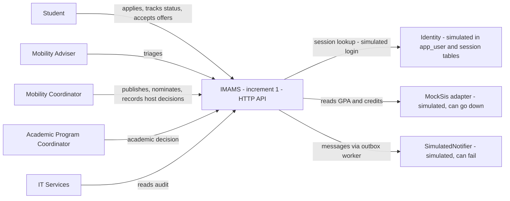
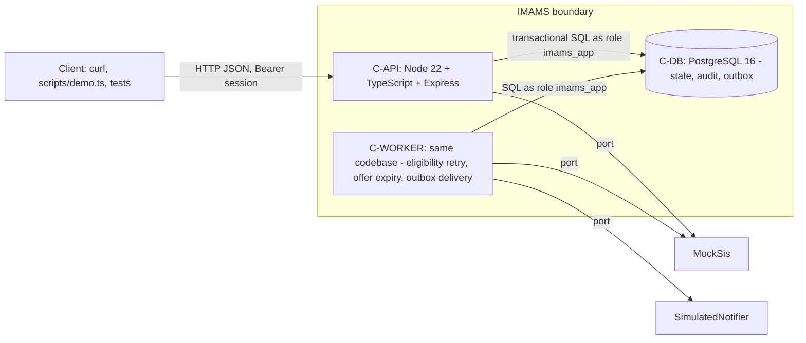
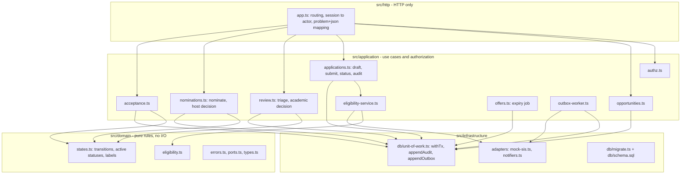
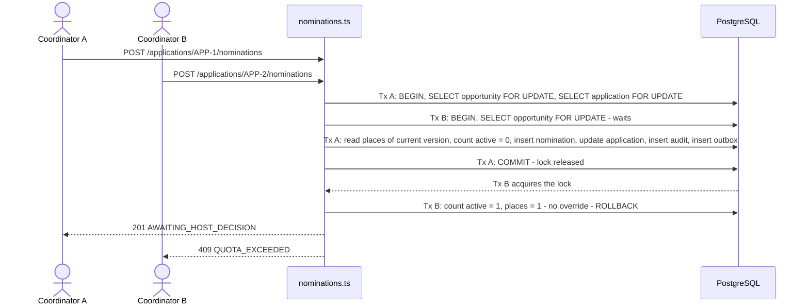
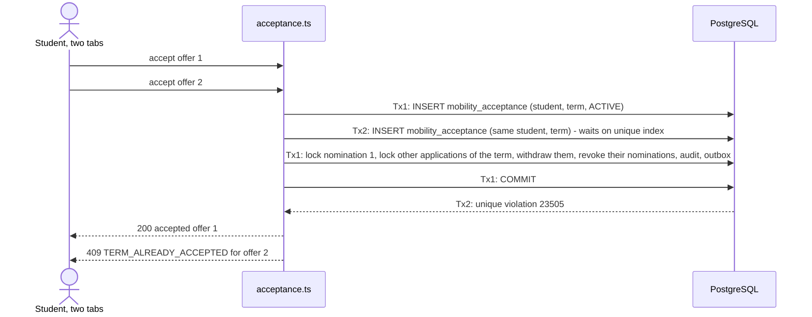
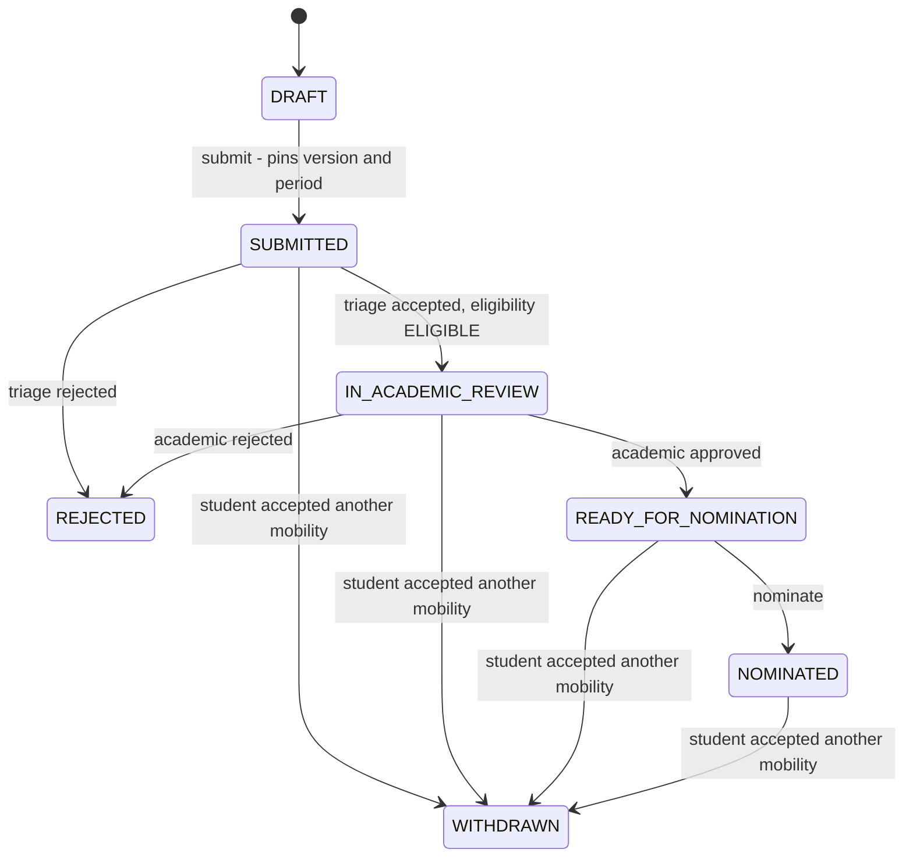
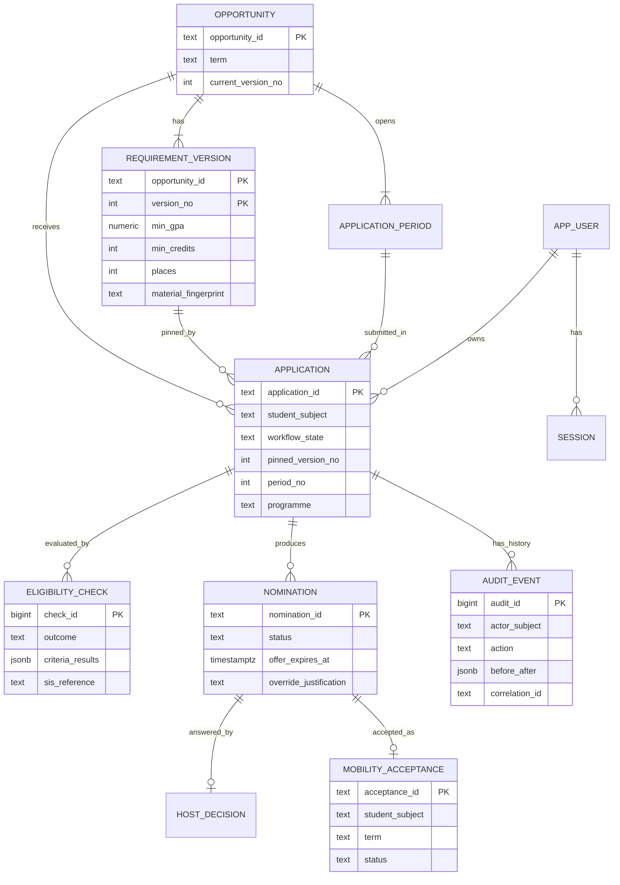
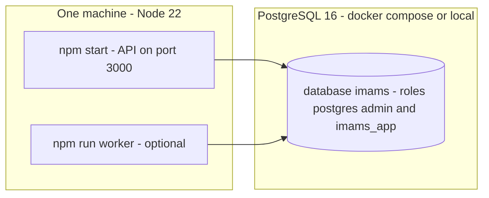

# Evaluation 3 — Architecture update and first increment

## IMAMS — International Mobility Application Management System (DH-04)

| Field | Value |
|---|---|
| Team | Laura González Rico, Jesús Marquez, Daniel Oliveros, Paulina Valencia |
| Document version | v0.2 — increment 1 (supersedes the *implementation* statements of Evaluation 2 `architecture-and-design.md` v0.1) |
| Source | `src/` in this delivery; tag `evaluation-3` |
| Scope rule | Every statement below is labelled **implemented**, **verified** (a test in `tests/` exercises it, result in `evidence/test-run.txt`), **simulated**, **designed** or **pending**. A diagram or a test plan never establishes that behaviour works. |

>*Did the proposed architecture become a real, verifiable software increment?*
>  Yes for the risk we chose: the **quota-integrity / single-acceptance / audit / least-privilege core** of the lifecycle was built end to end on the architecture of Evaluation 2 (modular monolith, relational transactions, ports/adapters, outbox). Change management (E2-ADR-010), documents (E2-ADR-008) are **designed, not built**; the web UI exists only as a static clickable prototype (`frontend/`) not yet connected to the API.

---

## 1. What the increment is

**Implemented use case (end to end, via HTTP API):**
`publish opportunity → student draft → submit → eligibility from the simulated SIS → adviser triage → academic approval → nomination against quota (with audited override) → host decision → student acceptance (single per term, with cascade) → status query → audit query`.

**Why this slice.** It contains the three decisions the architecture is *for* (QS-01 quota under concurrency, QS-08 single acceptance, QS-04 auditability), plus the two integration-failure scenarios (QS-03 SIS outage, QS-07 notification failure) and the access-control matrix (QS-05). These are the places where a wrong structure is expensive; a UI would not have tested any of them.

### 1.1 Status of each designed capability

| Capability (E2 reference) | Status | Evidence |
|---|---|---|
| Opportunity publication with immutable requirement version 1 and application period (ADR-001) | **Implemented, verified** | T-LIFE-01…05; `requirement_version` is not updatable by the app role (T-AUD-01) |
| Material / non-material classification of a *change* (ADR-001, BR-05) | **Partially implemented** — the material fingerprint is computed and stored at publication; there is no change flow that creates version 2 | — |
| Draft + submission pinned to version and period; period guard (BR-17 part) | **Implemented, verified** | T-LIFE-01, T-LIFE-03 |
| Eligibility from SIS, pass/fail only, `PENDING_VALIDATION` on outage, worker retry (ADR-005, QS-03) | **Implemented (SIS simulated), verified** | T-ELIG-01/02, T-INT-01/02/03, T-DATA-01 |
| Adviser triage; academic decision scoped by programme (US-017…020) | **Implemented, verified** | T-LIFE-02/04, T-SEC-05/06 |
| Nomination with per-opportunity lock, override with permission + justification (ADR-003, BR-04) | **Implemented, verified** | T-QUO-01…05 (100 concurrent trials) |
| Three records: application / nomination / host decision (ADR-004, BR-03) | **Implemented, verified** | T-LIFE-01, T-STAT-01 |
| Single accepted mobility per student per term, cascade withdrawal (ADR-011, BR-16) | **Implemented, verified** | T-ACC-01…03, 05 (50 concurrent trials) |
| Offer window and expiry (QS-09) | **Implemented, verified** | T-ACC-04, T-ACC-06 |
| Audit in the same transaction; append-only for the app role (ADR-006, QS-04) | **Implemented, verified** | T-LIFE-01, T-QUO-02, T-AUD-01/02 |
| Transactional outbox + notification retry (ADR-007, QS-07) | **Implemented (gateway simulated), verified** | T-NOT-01 |
| Identity + server-side scoped authorization (ADR-009, QS-05) | **Partially implemented** — simulated login by synthetic subject, server-side session, scope checks; no OIDC flow, no CSRF token | T-SEC-01…08 |
| Document versions and expiry (ADR-008, BR-07/08) | **Designed, pending** | — |
| Partner change proposal → impact preview → atomic return (ADR-010, BR-05/15/19) | **Designed, pending** | — |
| Partner selection (BR-18), decline, pre-departure checklist, reminders, reports | **Designed, pending** | — |
| Web UI (C-WEB) | **Static prototype** — role-based screens in `frontend/` (plain HTML/CSS/JS, hard-coded data, demo login); not connected to the API. The increment is exercised through the HTTP API, `scripts/demo.ts` and the tests | — |
| `If-Match` / `Idempotency-Key` headers | **Pending** — `row_version` columns exist but are not yet used for optimistic concurrency | — |

---

## 2. Updated architecture views

### 2.1 V-CTX — System context (unchanged boundary; adapters now exist)

*Changes vs E2 F01:* the **Partner Portal Simulator is not built**; host decisions are entered by the coordinator through the API (`POST /nominations/{id}/host-decisions`), which is the manual path E2 §5.1 already allowed when the partner portal is unavailable. The identity provider is a table lookup, not OIDC.

### 2.2 V-CONT — Containers as built

| Container | Status | Difference from E2 F02 |
|---|---|---|
| C-API | Implemented | Express instead of NestJS (E3-ADR-001) |
| C-WORKER | Implemented (`src/worker.ts`; also callable once via `POST /sim/worker/run` for the demo) | Runs three jobs: pending eligibility retry, offer expiry, outbox delivery |
| C-DB | Implemented | Two DB roles: migration/admin vs. runtime `imams_app` (E3-ADR-004) |
| C-WEB | **Not built** | — |
| C-DOCS | **Not built** | — |

### 2.3 V-COMP — Modules as built (and where each rule lives)

Dependency direction is enforced by tests: **T-ARCH-01** (domain imports nothing from HTTP, SQL or providers) and **T-ARCH-02** (application never imports HTTP).

| Rule | Where it lives (single place) | Not duplicated in |
|---|---|---|
| Active nominations ≤ places (BR-04) | `nominations.ts` inside the transaction holding the opportunity lock | HTTP layer, any client |
| One active nomination per application | Unique partial index `nomination_one_active_per_application` | application code |
| One accepted mobility per student per term (BR-16) | Unique partial index `mobility_acceptance_one_per_student_term` | application code (the code only translates `23505` into `TERM_ALREADY_ACCEPTED`) |
| Eligibility criteria (pass/fail) | `domain/eligibility.ts` (pure function) | SQL, HTTP |
| Legal transitions | `domain/states.ts` | HTTP |
| "Nominated ≠ admitted" labels | `domain/states.ts#nominationLabel` | clients |
| Audit append-only | DB grants in `schema.sql` (`REVOKE UPDATE, DELETE, TRUNCATE`) | application code |

### 2.4 V-SEQ-02 as implemented — two nominations race for the last place

*Verified by* T-QUO-01 (100 trials, independent pooled connections, each asserting exactly one `201` and one `409`, and `active ≤ places` straight from the database) and T-QUO-02 (the loser writes no audit and no outbox row).

### 2.5 V-SEQ-04 as implemented — two acceptances at once (lock order is part of the design)

If Tx2 starts *after* Tx1 committed, its offer is already `REVOKED`; the use case then answers `TERM_ALREADY_ACCEPTED` too (defect found by T-ACC-01, see §4).

### 2.6 V-STATE — implemented subset

Nomination states implemented: `AWAITING_HOST_DECISION → ADMITTED | REFUSED | REVOKED`, `ADMITTED → ACCEPTED | OFFER_EXPIRED | REVOKED`. **Not implemented:** `CORRECTION_REQUESTED`, `RETURNED_FOR_REAPPLICATION`, student-initiated withdrawal and `DECLINED`, resubmission of a `REJECTED` application (BR-17).

### 2.7 V-DATA — data model as implemented

Constraints that carry design decisions (all in `db/schema.sql`): composite FKs `(opportunity_id, pinned_version_no)` and `(opportunity_id, period_no)`; unique partial index on active nominations per application; unique partial index on `(student_subject, term) WHERE status='ACTIVE'`; no GPA/credit column outside the *thresholds* in `requirement_version` (T-DATA-01); `REVOKE UPDATE, DELETE, TRUNCATE` on `audit_event` and `requirement_version` for the runtime role. `outbox_event` and `session`/`adviser_assignment` are omitted from the diagram for readability.

### 2.8 Deployment (development / demonstration)

Single deployment unit, as accepted in E2 ("high availability vs. simple operation"). No cloud deployment was attempted in this increment.

---

## 3. Review of the Evaluation 2 decisions

| E2 decision | Outcome | What changed / what we learned |
|---|---|---|
| ADR-001 Immutable requirement versions | **Accepted, partial** | Versions are immutable (DB grant) and pinned at submission. The change flow that creates version 2 is pending. |
| ADR-002 Modular monolith + worker | **Accepted** | Boundaries are folder-level (`domain` / `application` / `infrastructure` / `http`) and tested (T-ARCH-01/02). The 13 conceptual modules of E2 collapsed to 9 use-case files; Documents, ChangeManagement, PreDeparture and Reporting do not exist yet. |
| ADR-003 Quota by transaction with opportunity lock | **Accepted, refined** | Verified under 100 concurrent trials. Refinement: lock order is *opportunity → application* (see E3-ADR-003 for the acceptance side). |
| ADR-004 Three decisions, three models | **Accepted** | Status endpoint composes four objects; label for a nominated application is "Nominated by Horizon - not yet admitted". |
| ADR-005 SIS authoritative | **Accepted, refined** | The `programme` of the student (needed to route academic review) is copied from the SIS at validation time and stored on the application as a routing attribute. This is not GPA/credits, but it *is* a second copy of SIS data; to be confirmed with the Registrar representative (new open question CL-026). |
| ADR-006 Audit in the business transaction | **Accepted** | Plus DB-level `REVOKE`; verified by T-AUD-01. Residual risk R-021 (superuser) unchanged. |
| ADR-007 Transactional outbox | **Accepted, simplified** | The `LEASED` state is replaced by a row lock with `FOR UPDATE SKIP LOCKED` during delivery (E3-ADR-006). Deadline reminders are pending. |
| ADR-008 Documents outside the DB | **Not implemented** | Out of this increment; the nomination guard therefore does **not** yet check "required documents accepted" from BR-02 (§5). |
| ADR-009 Identity ≠ authorization | **Accepted, partial** | Server-side role + scope checks verified. Identity is simulated (E3-ADR-005). |
| ADR-010 Partner change flow | **Not implemented** | The riskiest *business* decision of E2 remains un-validated by running code. It is the natural first work of the next iteration. |
| ADR-011 One acceptance per term | **Accepted, refined** | Lock-order rule added (E3-ADR-003); error contract corrected (§4). |

### New decisions taken while building

**E3-ADR-001 — Express + `pg` instead of NestJS + ORM.** *Context:* E2 §5.2 left the framework "to be confirmed". *Decision:* plain Express and `pg` with hand-written SQL. *Why:* the invariants depend on specific SQL (`FOR UPDATE`, `FOR SHARE`, partial unique indexes, `SKIP LOCKED`); an ORM would sit between those statements and the reader, and a small team needs to see them. *Cost:* no decorator-based DI or generated OpenAPI; manual validation. *Reconsider when:* the endpoint count makes manual validation error-prone.

**E3-ADR-002 — Persist the submission first, then ask the SIS.** *Decision:* submit commits state + a `PENDING_VALIDATION` eligibility row + audit + outbox in one transaction; the SIS is called after commit, and the same function (`evaluateCheck`) is used by the request path and the worker. The update is guarded by `outcome='PENDING_VALIDATION'`, so a race between them cannot write twice. *Verification:* T-INT-01/02/03.

**E3-ADR-003 — Acceptance lock order: insert the acceptance row first.** *Context:* a student accepts two offers of the same term simultaneously. *Decision:* (1) insert `mobility_acceptance` (blocks or fails on the unique index), (2) only then lock the nomination row, (3) then lock the student's other application rows. *Evidence:* with the nomination locked *before* the insert, PostgreSQL aborted a concurrent run with `deadlock detected (40P01)`; see `evidence/lock-order-experiment.md`. *Consequence:* acceptance never takes an opportunity row, so it cannot form a cycle with nomination (opportunity → application). *Guard:* T-ACC-01.

**E3-ADR-004 — Two database roles.** *Decision:* `schema.sql` is applied by an admin role; the application connects as `imams_app`, which has no `UPDATE`/`DELETE`/`TRUNCATE` on `audit_event` or `requirement_version`. *Why:* makes "append-only" a property of the database rather than a coding convention. *Verification:* T-AUD-01. *Cost:* two connection strings.

**E3-ADR-005 — Simulated identity.** *Decision:* `POST /auth/login {subject}` accepts only synthetic subjects present in `app_user` and issues an opaque random token stored in `session`; roles, programme and permissions are always read from `app_user` on each request. *Constraint honoured:* "authenticate through an institutional identity or simulated equivalent". *Limitations:* no password, no token expiry, no CSRF protection — acceptable only because the API has no browser client yet and only synthetic data (R-E3-04).

**E3-ADR-006 — Outbox lease by row lock.** See ADR-007 row above.

---

## 4. Design vs. real: divergences and defects found by building

| # | Finding | Found by | Resolution |
|---|---|---|---|
| F-1 | Deadlock if the nomination is locked before the acceptance insert | Reasoning while implementing, then confirmed by experiment | E3-ADR-003; `evidence/lock-order-experiment.md` |
| F-2 | **Defect:** a second concurrent acceptance that started *after* the first committed received `INVALID_STATE` (its offer was already `REVOKED`) instead of the contracted `409 TERM_ALREADY_ACCEPTED` | Test T-ACC-01 failed | Fixed in `acceptance.ts`: if the student already has an active acceptance for that term, answer `TERM_ALREADY_ACCEPTED`. T-ACC-01 now passes 50/50 |
| F-3 | **Gap:** overdue offers kept occupying a place until the student happened to try to accept them (the E2 worker job did not exist) | Review of the implementation against ADR-011 | Added `offers.ts#expireOffers` to the worker; T-ACC-06 |
| F-4 | New error code needed: `ELIGIBILITY_NOT_CONFIRMED` (409) when triage is attempted on a `PENDING_VALIDATION` or `INELIGIBLE` application | Implementing CL-015 | Added to the error vocabulary (E2 §8.3 had no code for it) |
| F-5 | E2 said the nomination guard checks "required documents accepted" (BR-02). Without the Documents module the guard checks `READY_FOR_NOMINATION` only (eligible + triaged + academically approved) | Scope decision | Documented as limitation L-3; BR-02 is **partially** implemented |
| F-6 | `programme` stored on `application` (see ADR-005 row) | Needed to scope academic review | Open question CL-026 |

## 5. Quality scenario status

| Scenario | Status | Evidence (test) |
|---|---|---|
| QS-01 Quota integrity | **Verified** — 100/100 concurrent trials | T-QUO-01, 02, 05 |
| QS-02 Partner change | **Not implemented** | — |
| QS-03 SIS outage | **Verified** (simulated SIS). The "validated within 60 s" measure is **not measured**: the worker retries every 5 s after a failed attempt, and the test forces a retry | T-INT-01 |
| QS-04 Auditability | **Verified** for implemented commands | T-QUO-02, T-AUD-01/02 |
| QS-05 Access control | **Verified** for implemented endpoints (8 negative cases) | T-SEC-01…08 |
| QS-06 Status clarity | **Partially**: labels are distinct and tested as text; the 5-participant usability test was **not run** | T-STAT-01, T-LIFE-01 |
| QS-07 Notification failure | **Verified** (simulated gateway) | T-NOT-01 |
| QS-08 Single acceptance | **Verified** — 50/50 concurrent trials | T-ACC-01, 02, 03 |
| QS-09 Offer window | **Verified** | T-ACC-04, 06 |
