# Evaluation 2 — Architecture and Design Review
## IMAMS — International Mobility Application Management System

| Field | Value |
|---|---|
| Institution | Horizon University — Digital Horizon Initiative |
| Project | DH-04 |
| Team / members | Laura González Rico, Jesús Marquez, Daniel Oliveros, Paulina Valencia |
| Document version / date | `[v0.1 — DATE]` |
| Source commit (if any) | `[COMMIT OR "none"]` |
| Status | **Design proposal, revision 2 (incorporates the client rules on partner changes, reapplication, multiple applications and single acceptance per term). Decisions marked *Proposed* until the team confirms them. No test has been executed unless `findings.md` says so.** |

Companion documents: [`validation/test-plan.md`](validation/test-plan.md) · [`project-status.md`](project-status.md) (risks, backlog, plan, readiness).
Source inputs: *Product Vision and Scope*, *Requirements/Backlog/Risk/Success-Criteria workbook* (US-xxx, R-xxx, SC-xx), *Stakeholder/Clarification/Assumption workbook* (STK-xx, CL-xxx, ASM-xxx).

> **Central question:** Can we justify how IMAMS should be structured?
> **Short answer:** a **modular monolith with a background worker**, one **relational database** that protects the critical invariants (quota, audit, versioned requirements) inside local transactions, a **separate document store**, and **ports/adapters** around the simulated SIS, identity provider, partner portal and notification gateway.

---

# 1. Purpose and agreed scope

**Problem (AS-IS).** Mobility applications live in email, forms, spreadsheets, shared folders and adviser records. Students cannot see status, confuse *nomination* with *host admission*, submit incomplete or expired documents; quotas are tracked in parallel spreadsheets; changes and overrides are not documented.

**Design goal.** One controlled outbound lifecycle — opportunity → application → validation → review → nomination → host decision → pre-departure — with a defensible history. The goal is **not** a nicer form; it is *one place* where the three decisions (application, nomination, admission) are kept apart and traceable.

| Scope layer | Content |
|---|---|
| Product design (this document) | Everything in *In scope* of the Product Vision. |
| Possible E2 proof of concept | One application: submit → SIS validation (with SIS outage) → triage → academic approval → **concurrent nominations against the last place** → **a confirmed partner change that returns every active application** → **concurrent acceptances by one student** → audit inspection. See §10 / `test-plan.md`. |
| Out of scope (unchanged) | Replacing the SIS, course enrolment, official transcripts, legal equivalency, visas/embassy services, flights/housing, real payments, partner admission platforms, **inbound mobility** (ASM-010), access-control integration, unencrypted storage of real ID files. |

**Naming.** *Application* = the student's request. *Nomination* = Horizon's endorsement (CL-003). *Host decision* = admission/refusal by the partner university. *Acceptance* = the student's own confirmation of an offered mobility (at most one per term). *Return for reapplication* = the system-driven closing of an application because the partner materially changed the opportunity. **A submitted application ≠ a nomination ≠ an admission ≠ an acceptance** (CL-002, CL-003).

---

# 2. Significant requirements, rules, constraints and assumptions

## 2.1 Architecturally significant requirements
Requirement text stays in the workbook; this table only says *why* each one shapes the structure.

| Requirement (workbook ID) | Why it is architecturally significant |
|---|---|
| US-002, US-004 versioned requirements; R-001; ASM-003; **CL-006 (closure proposed below)** | Requirements are **data with immutable versions**. A *material* partner change, once confirmed by the coordinator, **returns every active application** of that opportunity atomically and notifies everyone concerned. |
| *New client rules (this iteration):* partner change proposals, reopened application period with priority, several active applications per student, one accepted mobility per student per term, partner selection | A change-management workflow with impact preview; an application-period entity; a cross-opportunity consistency rule enforced by a unique constraint; a selection input to nomination. |
| US-011 destination change | Becomes **a new application** (CL-007 refined); there is no in-place destination change. |
| US-022, US-023 quota + override; SC-03; R-004; CL-008 | A **concurrency-safe** allocation check; override as a controlled, audited exception. |
| US-024, US-025 host decision / distinct labels; SC-06; R-003; CL-003 | **Separate models and state machines** for application, nomination, host decision. |
| US-012, US-036 eligibility from SIS; CL-005; STK-06 | SIS is **authoritative**; IMAMS must not become a second master of GPA/credits. |
| US-035, US-036; CL-011; R-002; ASM-008 | Failures of IdP/SIS/notifications must **not lose or invalidate** recorded work. |
| US-033 audit; SC-08; STK-08 | Audit written **in the same transaction** as the change; append-only. |
| US-013/014/015/016 documents; CL-009; R-005 | Immutable **document versions**, expiry vs. mobility start date, protected storage. |
| US-017–US-020 triage / academic review / routing | Controlled transitions, **scope-based** permissions (programme, opportunity). |
| US-029–US-031, US-028 notifications and reminders | Asynchronous, idempotent delivery; reminders derived from two deadlines (Horizon + partner). |
| US-032, US-034 reporting | Bounded, scoped read queries with shared definitions of *pending / delayed / at-risk*. |

## 2.2 Business rules and invariants

| ID | Rule | Source |
|---|---|---|
| BR-01 | Submitting an application does not secure a place. | CL-002 |
| BR-02 | A nomination requires a **validated** application: eligible vs. its pinned requirement version, required documents accepted, **academic decision recorded as approved**. | ASM-005, SC-07, US-019 |
| BR-03 | Nomination and host admission are separate records with separate student-facing labels. | CL-003, US-025 |
| BR-04 | *Active* nominations per opportunity (`AWAITING_HOST_DECISION`, `ADMITTED`, `ACCEPTED`) ≤ available places, unless an authorized override with mandatory justification is recorded. | US-022/023, SC-03 |
| BR-05 | A **material** change to an opportunity, confirmed by the coordinator, returns **all** its non-draft, non-terminal applications (including nominated, admitted and accepted ones) for reapplication. A non-material change returns none. Material = GPA, credits, language level, required documents, application period, destination. | Client rule, CL-006 (proposed closure) |
| BR-06 | GPA and credits are read from the SIS; IMAMS keeps no independent master copy. | CL-005, STK-06 |
| BR-07 | Uploaded document versions are immutable; replacing a document never erases earlier evidence. | US-014 |
| BR-08 | A document that expires before the mobility start date is flagged and an updated version requested. | CL-009, US-015 |
| BR-09 | A destination change is a **new application**; the old one is withdrawn by the student or stays active (several active applications are allowed). | CL-007 refined, client rule |
| BR-10 | Every status transition, decision and override has an immutable audit entry (actor, timestamp, reason). | US-033, STK-08 |
| BR-11 | SIS, IdP or notification failure cannot invalidate a committed submission or nomination. | CL-011, ASM-008 |
| BR-12 | The equivalency review is recorded but not a legal guarantee (UI wording must say so). | CL-010 |
| BR-13 | Visa status/evidence is recorded; verification with authorities is out of scope. | CL-012 |
| BR-14 | Authorization is enforced on the server for every protected operation. | STK-08 |
| BR-15 | A returned application is replaced by a **new application started from scratch** in a **new application period**; students whose returned application had reached academic approval or beyond get **priority**. | Client rule, CL-020 |
| BR-16 | A student may hold several active applications, but at most **one accepted mobility per term**; accepting one withdraws the student's other active applications of that term and releases their places. | Client rule, CL-024, CL-022 |
| BR-17 | A rejected application can be corrected and resubmitted **while its application period is open**. | Client rule, CL-025 |
| BR-18 | When valid candidates exceed the places, the **partner chooses** among them; the coordinator nominates only partner-selected candidates. *(Interpretation — see CL-023.)* | Client rule |
| BR-19 | Every return notifies all concerned parties (student, responsible adviser, academic coordinators, mobility coordinator) with: what changed, that the process must be redone, and the new deadline. | Client rule |

## 2.3 Assumptions and decisions still open
Existing: ASM-001…ASM-010. **CL-006** (what happens when a partner changes requirements) is answered by the client rule BR-05/BR-15 and is recorded as *closed – validate with client* in the Clarification Log (revision 1.1); **ASM-004 is reversed** and marked *superseded* (applications do *not* keep old requirements — they are returned); **CL-007** is refined by BR-09. **CL-008** (who may override) remains open. Added by this design — **proposed, not client-confirmed**:

| ID | Assumption / question | Why it matters | Validate with |
|---|---|---|---|
| CL-014 (new) | A nomination that is **refused, revoked, declined, expired, returned after a partner change, or replaced because the student accepted another mobility — or whose application is withdrawn — releases the place**. | Defines how quota is counted (BR-04). | Mobility Coordinator |
| CL-015 (new) | An application that fails automatic eligibility **is accepted but flagged** and cannot advance past triage; the adviser records the rejection. | Defines submit behaviour and SC-02. | Mobility Adviser / Coordinator |
| CL-016 (new) | Definitions and thresholds of *delayed* and *at-risk* (e.g. days in a state; days before a deadline). | Needed for US-032 / SC-09. | Mobility Coordinator |
| CL-017 (new) | The eligibility result may be stored as **pass/fail per criterion + SIS reference/timestamp**, without raw GPA/credit values. | Reconciles auditability with STK-06. | Registrar rep, IT Services |
| CL-018 (new) | Notification gateway is a simulated email service; the **Scholarship representative (STK-07) has no user story** yet — role and notices to be defined. | Missing stakeholder coverage. | Scholarship rep, Product Owner |
| CL-019 (new) | Non-material examples: more places, text corrections, longer deadline. **To confirm:** is a *reduction* of places, or a *shortened* deadline, material? Proposal: neither returns applications, but a reduction below the active nominations is refused until the coordinator revokes nominations. | Fixes the material/non-material boundary (ADR-001). | Mobility Coordinator |
| CL-020 (new) | "Previously approved" = reached academic approval (`READY_FOR_NOMINATION`) or beyond. **Effect of priority:** flag visible to advisers, academic coordinators and the partner, and ordering of review queues — **advisory, not binding on the partner's selection**. | BR-15 and ordering of work queues. | Mobility Coordinator |
| CL-021 (new) | The client rule returns *all* applications, including those already **admitted or accepted**. Confirm that this is intended (partner-side admission records, pre-departure data and visa evidence are invalidated). | Largest impact on students and partners (R-018). | Mobility Coordinator, partner contacts |
| CL-022 (new) | "Period" in the single-acceptance rule = the **mobility term** of the opportunity (e.g. 2027-S1). Length of the acceptance window per opportunity, and consequence of expiry (proposal: offer lapses, place released). | BR-16, ADR-011. | Mobility Coordinator |
| CL-023 (new) | **Partner selection vs quota.** Interpretation used: Horizon may nominate at most *places* candidates and, if valid candidates exceed places, only partner-selected ones; admission remains a later partner decision. Alternative: Horizon nominates more than *places* and the partner admits among them. | BR-04/BR-18, ADR-003. | Mobility Coordinator, partner contact |
| CL-024 (decided) | A student may hold **several active applications**; after admission there is an offer window and accepting one offer withdraws the others of that term. *Team decision, validate with the client.* | BR-16, ADR-011. | Mobility Coordinator |
| CL-025 (decided) | A rejected application can be corrected and resubmitted **while its period is open**. *Team decision, validate with the client.* | BR-17. | Mobility Adviser |

---

# 3. Quality scenarios and architecture drivers

All targets are **proposed, not measured**.

| ID | Scenario (source → stimulus → response) | Response measure | Evidence |
|---|---|---|---|
| **QS-01** Quota integrity | Two coordinators nominate two different validated applicants for the **last remaining place** at the same moment (healthy DB/API). | In each controlled trial exactly one `201` and one `409 QUOTA_EXCEEDED`; active nominations never exceed places; one audit set. | T-QUO-01 (100 coordinated trials, independent connections) |
| **QS-02** Partner change | Partner proposes a *material* change (higher GPA); the coordinator confirms after the impact preview while 6 applications are active (submitted, in review, ready, nominated, admitted) and 3 drafts exist. | All 6 are returned in **one transaction** (nominations revoked, places released, new priority period opened); one notice per concerned person says what changed, that the process must be redone and the new deadline; drafts are kept and revalidated; a submission racing the change is either returned or pinned to the new version; a failed notification does not undo the return. A *non-material* change returns none. | T-CHG-01/02/03, T-VER-01 |
| **QS-03** SIS/IdP outage | SIS is down while a student submits. | Submission and documents persist; eligibility = `PENDING_VALIDATION`; validated automatically within 60 s after SIS returns; user told it is pending. | T-INT-01 |
| **QS-04** Auditability | Auditor reconstructs one application from submission to host decision. | Every accepted transition/decision/override present with actor, time, reason, before/after; a rolled-back command leaves **no** success record; application role cannot update/delete audit rows. | T-AUD-01/02 |
| **QS-05** Access control | Student, out-of-scope adviser, non-authorized coordinator try protected actions by calling the API directly. | All cases of the negative matrix denied; zero protected writes; no leakage of other students' documents/data. | T-SEC-01…03 |
| **QS-06** Status clarity | Five participants read screens of: nominated-awaiting-host, admitted, refused. | ≥ 4 of 5 correctly say who decided what and what is final. *(R-003)* | T-UX-01 |
| **QS-07** Notification failure | Notification gateway fails after a nomination commits. | Nomination stays committed; delivery retried; failure visible to IT. | T-NOT-01 |
| **QS-08** Single acceptance | A student holds 3 active applications and accepts two offers of the same term **at the same moment**. | Exactly one acceptance succeeds, the other gets `409 TERM_ALREADY_ACCEPTED`; the student's other active applications of that term are withdrawn, their nominations revoked and places released, all in the winner's transaction. | T-ACC-01/02 |
| **QS-09** Offer window | An offer expires while the student is clicking *accept*. | Exactly one outcome (server time decides); an expired offer releases the place. | T-ACC-03 |

## Architecture drivers

| Driver | Evidence | Consequence for the structure |
|---|---|---|
| **AD-01** Partner-driven change | US-002/004, R-001 (High/High), ASM-003, client rule on returns, QS-02 | Immutable requirement **versions**; a change **proposal → impact preview → coordinator confirmation → atomic return** of affected applications. |
| **AD-02** Quota integrity | US-022/023, SC-03, QS-01 | Single authoritative allocation boundary; lock + count in one transaction. |
| **AD-03** Distinct decisions | CL-003, SC-06, R-003 | Separate Application / Nomination / HostDecision models. |
| **AD-04** Reconstructable history | US-033, SC-08, QS-04 | Audit in the business transaction; append-only. |
| **AD-05** Resilient integrations | CL-011, R-002, ASM-008 | Adapters behind ports; durable outbox; retry of validation. |
| **AD-06** Scoped access and protected documents | STK-08, R-005, ASM-009 | Trusted identity + server-side scoped authorization; documents outside the DB, access via API only. |
| **AD-07** Feasible for a small semester team | Scope, synthetic data | Few runtime parts; reproducible local environment. |
| **AD-08** Student-level consistency across opportunities | Client rule on multiple applications and single acceptance, QS-08 | A unique constraint per student and term, plus a cascade in the same transaction. |

## Tensions and accepted costs

| Tension | Resolution | Accepted cost |
|---|---|---|
| Immediate SIS validation vs. SIS availability | Persist first, validate asynchronously if needed | A student may see "validation pending". |
| SIS is master vs. need to explain past eligibility | Store pass/fail + SIS reference, not raw values *(CL-017)* | Cannot re-display historical raw GPA without asking the SIS. |
| Configurable rules vs. simplicity | Small validated rule vocabulary (thresholds, language level, document set, routing table) — no scripts | Exotic rules need a new design. |
| Strong quota guarantee vs. throughput | Row lock per opportunity | Nominations for the *same* opportunity serialize (acceptable at this scale). |
| High availability vs. simple operation | Single deployment | Host/DB failure interrupts service. |
| Rich audit vs. privacy | Audit stores business facts, not document contents | Debugging detail lives only in operational logs. |
| Partner autonomy vs. student stability | The partner only **proposes**; the coordinator confirms after an impact preview | One human step and some delay before a change takes effect |
| Fairness to returned students vs. simplicity | New application from scratch, priority flag only (no data precarga, no automatic place) | Students redo all the work; priority is advisory |

---

# 4. Alternatives and decision records

## 4.1 Structural alternatives

| Candidate | Fit | Cost / risk | Conclusion |
|---|---|---|---|
| Poorly modularized single app | Quick start | Rules for quota/versioning/audit become entangled | Reject the poor modularity, not the single deployment. |
| **Modular monolith + worker** | Local transactions for quota + audit; one release; explicit module contracts | Boundaries need enforcement (tests/reviews) | **Selected (Proposed).** |
| Independent microservices (opportunities, applications, nominations…) | Independent scaling/teams | Cross-service consistency for quota and audit; deployment/observability cost | No demonstrated need for a semester team. |
| Serverless functions | Fits isolated async tasks | Splits the core workflow and transactions | Not for the core; maybe reminders later. |

## 4.2 Decision register
Owner/date to be filled by the team; status is **Proposed** until confirmed.

| ID | Decision | Drivers |
|---|---|---|
| E2-ADR-001 | Immutable requirement versions with material / non-material classification | AD-01 |
| E2-ADR-002 | Modular monolith + background worker | AD-07, AD-02 |
| E2-ADR-003 | Quota enforced by relational transaction with per-opportunity lock | AD-02, AD-04 |
| E2-ADR-004 | Separate Application, Nomination and HostDecision models | AD-03 |
| E2-ADR-005 | SIS authoritative; eligibility stored as outcome + source reference | AD-05, AD-01 |
| E2-ADR-006 | Audit written in the same transaction; append-only | AD-04 |
| E2-ADR-007 | Transactional outbox for notifications/reminders; retried validation | AD-05 |
| E2-ADR-008 | Documents in a separate protected store; immutable versions | AD-06 |
| E2-ADR-009 | Institutional identity adapter + server-side scoped authorization | AD-06 |
| E2-ADR-010 | Partner change: proposal → impact preview → confirmation → atomic return of applications | AD-01, AD-04 |
| E2-ADR-011 | One accepted mobility per student per term, with cascading withdrawal | AD-08, AD-02 |

### E2-ADR-001 — Version the requirements and detect material change
**Context.** Eligibility thresholds, language level, document set, routing, period and places vary per opportunity and partners change them during live cycles (CL-004, R-001, High/High). The client rule is that a **material** change returns every active application.
**Decision.** Each opportunity has immutable `RequirementVersion` records. Each version has a **material part** (min GPA, min credits, language level, required document types, routing table, application period, destination) and a **non-material part** (places, deadline details, descriptive text). The system stores a fingerprint of the material part; a new version whose fingerprint differs is *material* — the classification is computed, not judged by hand. Eligibility is evaluated against the version **pinned** at submission (traceability); places and deadlines are always read from the **current** version.
**Alternatives.** Hard-coded rules per destination; free-form scripts; external rules engine; keeping old applications on old rules (the earlier proposal, rejected by the client).
**Consequences.** + A change needs no deployment; history is complete; the material boundary is testable. − We own validation of the rule vocabulary and retention of versions; the boundary of "material" is a policy (CL-019).
**Verification.** QS-02, T-VER-01, T-ELIG-01, T-CHG-01. **Reconsider when** rules need conditional logic beyond the vocabulary.
**Links.** US-002/003/004/020 · AD-01 · BR-05.

### E2-ADR-002 — Modular monolith with a worker
**Context.** Strong consistency needed for quota/audit; small team; simulated integrations.
**Decision.** One backend codebase organized in modules (Opportunities, ChangeManagement, Applications, Documents, Eligibility, Review, Nominations, Acceptance, PreDeparture, Notifications, Reporting, Audit, Authorization), one PostgreSQL database, and a worker process from the *same release* for asynchronous work.
**Alternatives.** Microservices; serverless; non-modular monolith.
**Consequences.** + Local transactions, simple test and release. − Module boundaries can erode; no independent scaling.
**Verification.** T-ARCH-01 (forbidden imports), T-ENV-01. **Reconsider when** measured scale or independent ownership justifies extraction.

### E2-ADR-003 — Quota is a persistence obligation
**Context.** "Places left" read on screen can be stale before the nomination is written; two coordinators can race (STK-03 concern).
**Decision.** Nomination runs in one transaction that **locks the opportunity row** (`SELECT … FOR UPDATE`), counts active nominations, compares with the places of the current requirement version, and inserts the nomination, audit event and outbox event together. Exceeding requires `nomination.override` permission plus a non-empty justification stored on the nomination. A unique partial index allows one *active* nomination per application. The same opportunity-row lock is taken **exclusively** by change confirmation (ADR-010) and in **shared** mode by submission, so these operations are serialized.
**Alternatives.** UI/application pre-check only; a process-local lock; a stored counter with CHECK (needs careful decrement on release); serializable isolation with retry.
**Consequences.** + Correct across processes; simple to reason about. − Same-opportunity nominations serialize; DB-specific. **Active = `AWAITING_HOST_DECISION`, `ADMITTED`, `ACCEPTED`; refused, revoked, declined, expired and returned nominations release the place (CL-014).**
**Verification.** QS-01, T-QUO-01/02/03.
**Reconsider when** places become divisible/waitlisted or several writers exist.

### E2-ADR-004 — Three decisions, three models
**Context.** Students confuse nomination with admission (CL-003, R-003, High impact).
**Decision.** `Application` (workflow state), `Nomination` (Horizon's endorsement; states `AWAITING_HOST_DECISION / ADMITTED / ACCEPTED / DECLINED / OFFER_EXPIRED / REFUSED / REVOKED`) and `HostDecision` (who recorded, when, outcome) are separate records; the API exposes them as distinct objects, and the UI uses distinct labels ("Nominated by Horizon", "Admitted by host university", "Accepted by you").
**Alternatives.** One status column with many values; free-text status.
**Consequences.** + Impossible to display "admitted" from a nomination alone. − More tables; status endpoint must compose several records.
**Verification.** T-STAT-01, T-UX-01.

### E2-ADR-005 — The SIS stays the master of academic data
**Context.** STK-06, CL-005: no independent copy of GPA/credits; CL-011: SIS may be unavailable.
**Decision.** An `AcademicRecordPort` with a mock-SIS adapter. Eligibility evaluation reads GPA/credits, compares them to the pinned requirement version, and stores **only** `EligibilityCheck(outcome, per-criterion pass/fail, requirement_version, sis_reference, checked_at)`. If the SIS is unavailable the check is `PENDING_VALIDATION` and the worker retries.
**Alternatives.** Periodic full copy of academic records; manual entry by advisers.
**Consequences.** + No drift, easy privacy argument. − Historical raw values are not reproducible locally; depends on **CL-017**.
**Verification.** T-ELIG-01, T-INT-01, T-CONTRACT-01.

### E2-ADR-006 — Audit inside the business transaction
**Decision.** Each accepted mutation appends an `AuditEvent` (actor, action, target, before/after, reason, correlation id, time) in the same transaction. The application's DB role has INSERT/SELECT only on audit tables.
**Alternatives.** Logging after commit; application-level logging only; event sourcing (too heavy).
**Consequences.** + Rollback leaves no false history. − A DB superuser can still alter history (residual risk R-021).
**Verification.** T-AUD-01/02.

### E2-ADR-007 — Transactional outbox for notifications and reminders
**Decision.** Status-change notices are rows in an outbox written with the business change; the worker claims them, calls the notification adapter, and records delivery state (`PENDING → LEASED → DELIVERED / RETRY_WAIT / DEAD_LETTER`). Deadline reminders are generated by a scheduled job with an idempotency key `(application, deadline, offset)`.
**Alternatives.** Send inside the request; in-memory queue; external broker.
**Consequences.** + Notification failure cannot undo a submission (ASM-008). − Eventual delivery; duplicates possible → idempotent templates.
**Verification.** QS-07, T-NOT-01.

### E2-ADR-008 — Documents live outside the database
**Decision.** Files go to an encrypted document store (local volume/object store in the demo); the DB keeps `DocumentVersion(hash, size, storage_key, expires_on, status, reviewer, reason)`. Files are never served by public URL: every download passes through the API's authorization. Only **synthetic** documents (ASM-009).
**Alternatives.** BLOBs in PostgreSQL; public object URLs.
**Consequences.** + Smaller DB, clearer privacy boundary. − Two stores to back up and keep consistent (orphan-file cleanup job).
**Verification.** T-DOC-01/02, T-SEC-02.

### E2-ADR-009 — Identity is not authorization
**Decision.** Authentication via an `IdentityPort` (simulated OIDC provider). A server-side session; role assignments with scope (adviser → opportunities, academic coordinator → programmes, coordinator → opportunities) are resolved locally and checked on every command and query. Default deny; override permission is a distinct permission (role to be set by CL-008).
**Alternatives.** Trust role claims from the browser; login-only check.
**Consequences.** + Reviewable, testable rules. − Role-assignment management and negative tests are part of the work.
**Verification.** QS-05, T-SEC-01…04.

### E2-ADR-010 — A partner change is proposed, previewed, confirmed, then applied atomically
**Context.** Partners change requirements (R-001). The client rule: a material change returns **all** applications, everyone concerned is told what changed and that they must redo the process, a **new application period** opens, and previously approved students get priority. The blast radius is large, so a mistaken or forged change would be costly.
**Decision.** Partner staff submit a `ChangeProposal` through the simulated partner portal (no IMAMS account); the coordinator registers it. The system classifies it (ADR-001) and shows an **impact preview** (applications by state, nominations to revoke, places released, drafts kept, notices to send, opportunity ETag). On **confirmation** — which requires the ETag and, for a material change, the dates of the new application period — one transaction: locks the opportunity row exclusively → inserts the new version → closes the current period and opens the new one → marks every non-draft active application `RETURNED_FOR_REAPPLICATION` → revokes their nominations and cancels open review tasks and checklists → writes one audit event per application plus one for the change → writes the notice events to the outbox. **Drafts are kept** and revalidated against the new version when submitted. Each returned student then starts a **new application from scratch**, linked to the old one only to compute priority and keep history.
**Alternatives.** Apply the partner change automatically; keep old applications on old rules (rejected by the client); return applications one by one by hand; partner logs into IMAMS and edits directly (adds an external role and enlarges scope).
**Consequences.** + Consistent outcome, complete audit, no half-returned opportunity. − A wrong confirmation returns everyone and cannot be undone (a new change opens a new period); the batch holds the opportunity lock for its duration (fine for tens or hundreds of applications; thousands would need chunked processing).
**Verification.** T-CHG-01/02/03, T-PRI-01, T-NOT-01. **Reconsider when** volume or the partner-login requirement changes.
**Links.** BR-05, BR-15, BR-19 · AD-01, AD-04 · QS-02 · CL-019/020/021.

### E2-ADR-011 — One accepted mobility per student per term
**Context.** A student may apply to several opportunities. After a host admits the student, the student has a window to accept; once the student accepts one, the student is removed as a candidate from the others of that term (client rule). Races between two acceptances, and between acceptance and nomination, must not leave a student accepted twice or a place held by a withdrawn candidate.
**Decision.** An `ACCEPTED` offer inserts a `MobilityAcceptance(student_subject, term)` row protected by a **unique constraint over active rows**. In the same transaction the system withdraws the student's other active applications of that term (reason `ACCEPTED_ANOTHER`, actor *system*), revokes their nominations (releasing places), cancels open tasks, creates the pre-departure checklist for the accepted mobility, writes the audit events and the notices. Offers carry `offer_expires_at`; the worker expires them. **Lock order:** acceptance takes the student/term row, then application rows; nomination takes the opportunity row, then the application row; acceptance never takes an opportunity row, so no cycle can form.
**Alternatives.** Application-level check only; nightly clean-up job; letting the coordinator withdraw the other applications manually.
**Consequences.** + The rule holds across processes and opportunities; released places can be re-nominated. − Other pending decisions of the student disappear (notified); a return (ADR-010) must also release the acceptance row.
**Verification.** T-ACC-01/02/03, T-QUO-04.
**Reconsider when** terms overlap or a student may hold several mobilities (CL-022).
**Links.** BR-16 · AD-08 · QS-08/09.

---

# 5. Architecture views

## 5.1 V-CTX — System context

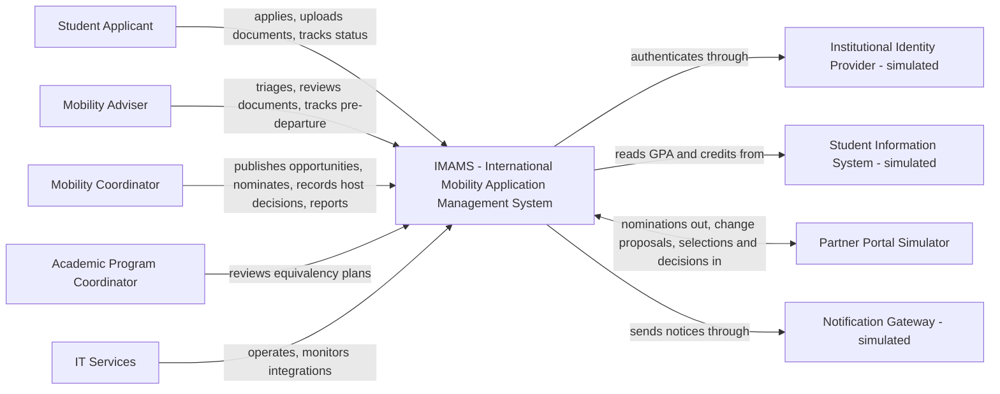
*Figure F01.* IMAMS owns applications, nominations, host-decision records, documents' metadata and history. It does **not** own identity credentials, academic records (SIS), partners' admission platforms or the notification provider.

| External party | IMAMS expects | IMAMS provides | If unavailable |
|---|---|---|---|
| Identity Provider | Verified subject | Login initiation/callback | New logins fail safely; no invented identity. |
| SIS | GPA, completed credits, enrolment status for a student id | Read requests only | Submission persists; eligibility `PENDING_VALIDATION`; retried. |
| Partner Portal Simulator | Accepts nominations; exposes **change proposals**, **candidate selections** and decision records. Partner staff work in the simulator; **IMAMS has no partner login** (ASM-007) | Nomination payload; the impact preview is shown to the coordinator, not to the partner | Nomination stays committed; delivery retried; coordinator can register proposals and decisions manually. |
| Notification Gateway | Accepts message | Minimal template payload | Delivery retried; business state unaffected. |

## 5.2 V-CONT — Containers

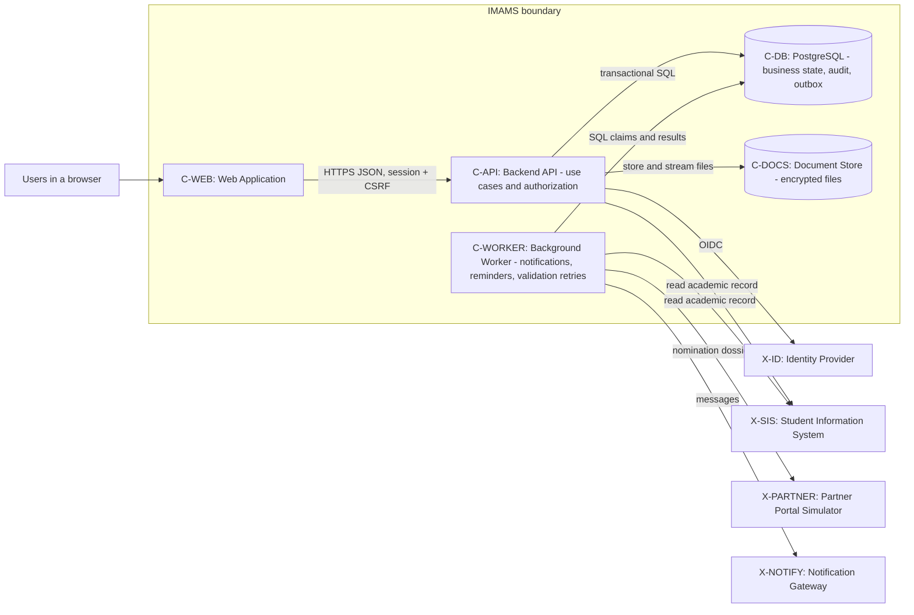
*Figure F02.* The outbox lives inside C-DB: there is no extra queue server.

| Container | Owns | Does **not** own |
|---|---|---|
| C-WEB | Wizard, status screens, work lists | Authorization decisions; direct DB/file access |
| C-API | Commands/queries, authorization, domain rules, transaction orchestration, SIS calls for validation | Sending notices inline |
| C-WORKER | Outbox delivery, reminders, retry of pending eligibility checks | Deciding eligibility rules, nominations or approvals |
| C-DB | Durable records, constraints, audit, outbox | Business policy |
| C-DOCS | File bytes, encrypted at rest | Authorization (API enforces it) |

**Technology binding (to be confirmed by the team):** relational DB with row-level locking and transactions (PostgreSQL proposed); web framework/language `[TEAM TO COMPLETE]`. The design depends on the *properties* (transactions, locks, constraints), not on a framework.

## 5.3 V-COMP — Inside the Backend API

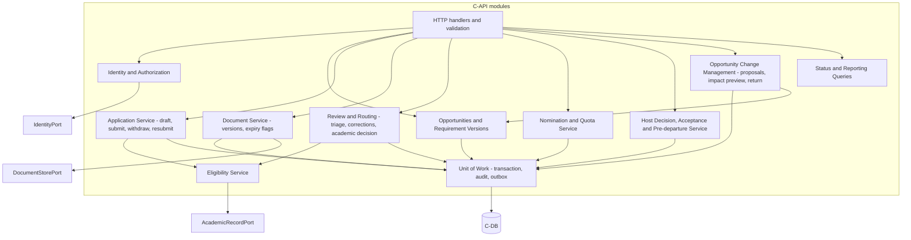
*Figure F03.* Responsibility view. Every protected service is reached through authorization (only the main edge is drawn).

**Component card — Nomination and Quota Service**

| Field | Design |
|---|---|
| Purpose | Create/revoke nominations while preserving quota, validation and history invariants. |
| Operations | `nominate(application_id, override?, ctx)`, `revoke(nomination_id, reason, ctx)`. |
| Dependencies | Authorization, Unit of Work, application/eligibility/review read ports, requirement-version repository, audit + outbox appenders. |
| State owned | Nomination records and their status. |
| Failure contract | `NOT_NOMINATABLE`, `QUOTA_EXCEEDED`, `OVERRIDE_NOT_PERMITTED`, `PRECONDITION_FAILED`, `FORBIDDEN`. |
| Forbidden | Counting places from the UI; calling partner portal inside the transaction; override without justification. |
| Verification | T-QUO-01/02/03, T-AUD-01. |

**Component card — Opportunity Change Management**

| Field | Design |
|---|---|
| Purpose | Turn a partner's proposed change into a previewed, confirmed and atomic outcome. |
| Operations | `register_proposal`, `preview_impact`, `confirm(proposal_id, etag, new_period?)`, `reopen_period`. |
| Dependencies | Opportunity/requirement repositories, application and nomination services (revoke), Unit of Work, notice templates. |
| State owned | `ChangeProposal`, new `RequirementVersion` rows, `ApplicationPeriod`. |
| Failure contract | `PRECONDITION_FAILED` (stale preview), `VALIDATION_FAILED` (material change without new period), `ACTION_FORBIDDEN`. |
| Forbidden | Applying a partner change without coordinator confirmation; editing a version in place; returning applications outside the confirmation transaction. |
| Verification | T-CHG-01/02/03. |

## 5.4 Source organization (enforces the same boundaries)

`web/` → HTTP only → `backend/http` → `backend/application` (use cases, ports) → `backend/domain` (entities, rules). `backend/infrastructure` (DB, SIS/IdP/partner/notify adapters, file store) implements the ports; `bootstrap/` composes API and worker. The domain imports nothing from HTTP, SQL or provider SDKs; **T-ARCH-01** checks it.

---

# 6. Domain, data and state design

## 6.1 Domain model (V-DOM)

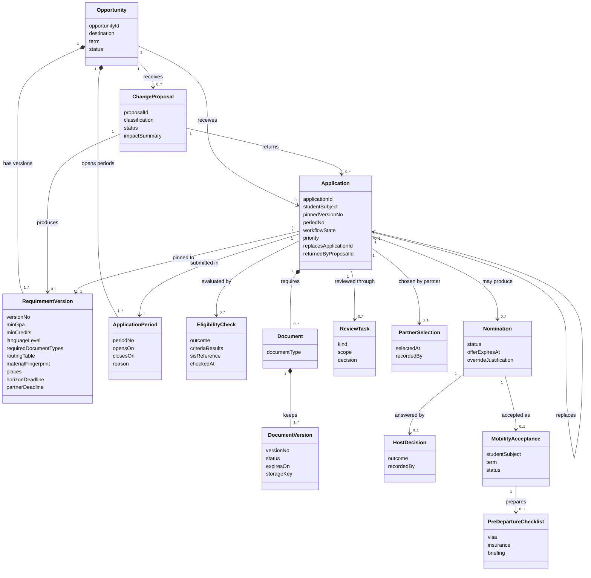
*Figure F04.* `studentSubject` is a reference to the SIS/IdP subject; student academic data is **not** a domain entity (BR-06). A student may have **several** applications (BR-16); `replaces` links a new application to the returned one only for priority and history — **no data is copied** (BR-15).

## 6.2 Logical data model (V-DATA)

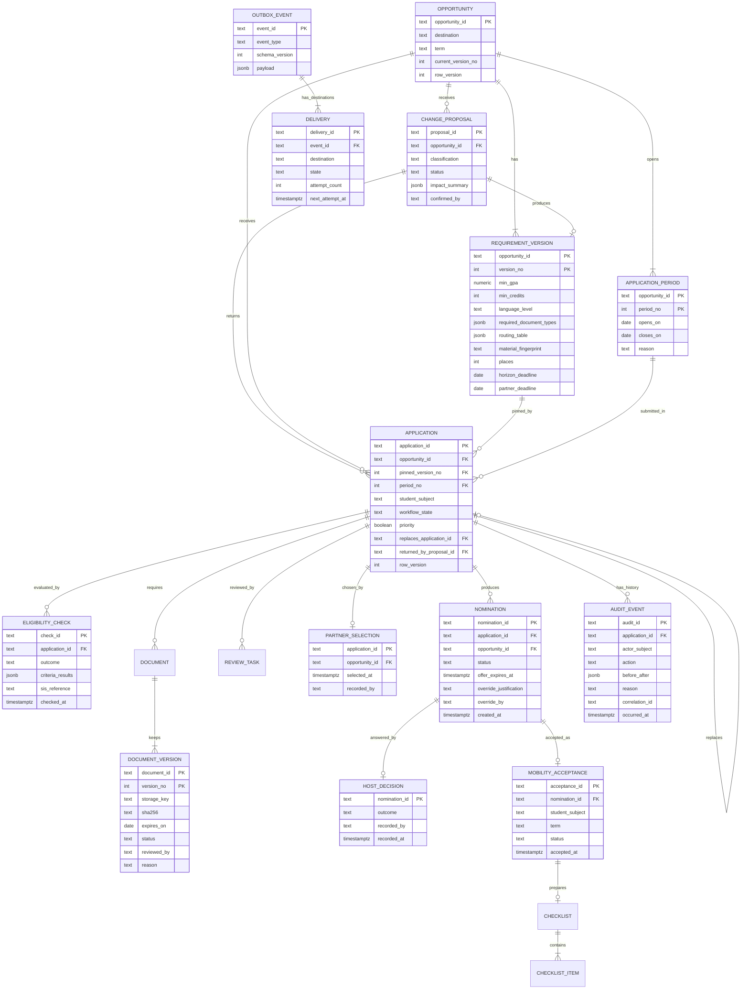
*Figure F05.* Key constraints: composite FKs `(opportunity_id, pinned_version_no)` and `(opportunity_id, period_no)`; `REQUIREMENT_VERSION` rows are never updated; unique partial index on `NOMINATION(application_id)` over active statuses; **unique partial index on `MOBILITY_ACCEPTANCE(student_subject, term)` where `status = 'ACTIVE'`**; `AUDIT_EVENT` insert-only for the application role; `UNIQUE(event_id, destination)`. A returned acceptance becomes `RELEASED`, so the student can accept again after reapplying.

## 6.3 Where each invariant is enforced

| Invariant | Primary enforcement | Supporting evidence |
|---|---|---|
| Active nominations ≤ places (BR-04) | Row lock on opportunity + count, in the nomination transaction | T-QUO-01/02 |
| One active nomination per application | Unique partial index | T-QUO-03 |
| Eligibility traceable to a pinned version | Composite FK; requirement versions immutable | T-VER-01 |
| Material change returns **all** active applications (BR-05) | One transaction under the **exclusive** opportunity lock; submission takes it in **shared** mode | T-CHG-01/02 |
| One accepted mobility per student per term (BR-16) | Unique partial index on `MOBILITY_ACCEPTANCE` + cascade in the same transaction | T-ACC-01 |
| Resubmission only while the period is open (BR-17) | Application-service guard against the current `ApplicationPeriod` | T-LIFE-03 |
| Nomination requires validated application (BR-02) | Application-service guards inside the transaction | T-LIFE-01, T-QUO-03 |
| Document versions immutable (BR-07) | Insert-only repository; no update path | T-DOC-01 |
| Audit with every mutation (BR-10) | Same Unit of Work; DB grants | T-AUD-01/02 |
| Authorization (BR-14) | Server-side checks before command | T-SEC-01…03 |

## 6.4 Application lifecycle (V-STATE-APP)

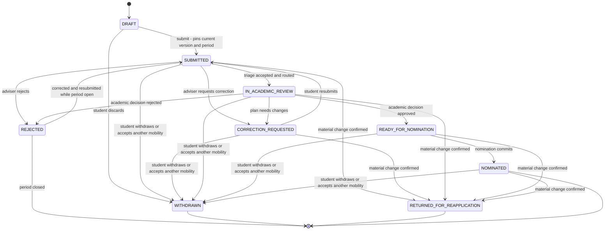
*Figure F06.* `RETURNED_FOR_REAPPLICATION` is deliberately different from `WITHDRAWN`: reports and audit can tell "the student left" from "the partner's change forced a new application". **Drafts are not returned**; they are revalidated when submitted. A returned student starts a **new application from scratch** (BR-15). A destination change is likewise a new application (BR-09), so there is no in-place destination change. A `REJECTED` application may be corrected and resubmitted only while its period is open (BR-17); a resubmission repeats eligibility validation and review.

## 6.5 Nomination, offer and acceptance (V-STATE-NOM)

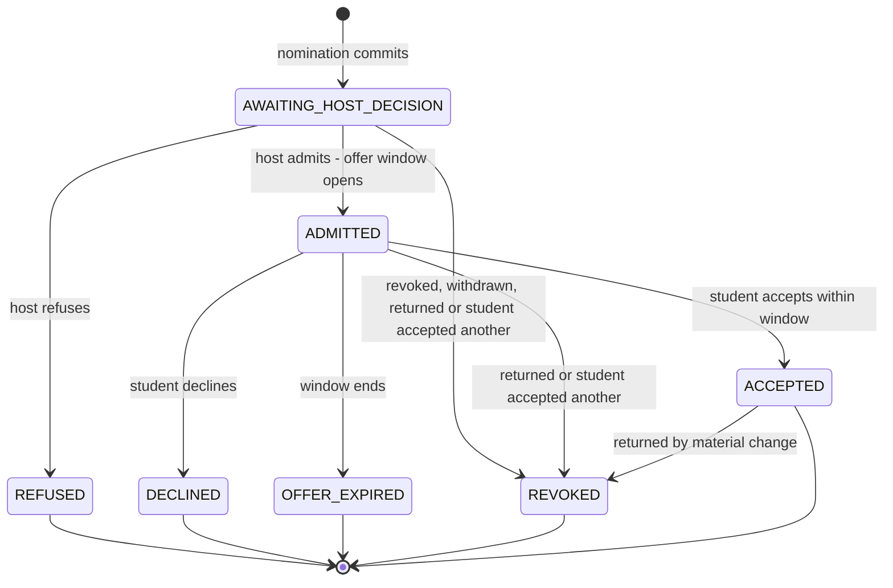
*Figure F07.* `ACCEPTED` creates the `MobilityAcceptance` and the pre-departure checklist (visa evidence, insurance, briefing). Refused, declined, expired and revoked nominations **release the place** (CL-014). A material change also reaches `ACCEPTED` nominations (CL-021), releasing the acceptance so the student can reapply and accept again.

**Partner selection (BR-18, CL-023).** The partner records, through the simulator, which valid candidates it chooses; the coordinator registers the selection. When valid candidates exceed the places, the nomination guard accepts only selected candidates (`NOT_PARTNER_SELECTED` otherwise). The priority flag (CL-020) is shown next to each candidate but does not bind the partner.

**Statuses shown to the student** (so the interface never says "accepted" prematurely): application state and next action · eligibility/document completeness · nomination ("Nominated by Horizon — not yet admitted") · host decision ("Admitted / Not admitted by host university") · own acceptance ("You accepted this mobility" / "Offer open until …"). For a returned application the screen shows *what changed*, *that a new application is required* and *the new deadline*, plus a priority badge when applicable.

| Transition | Actor and guard | Committed side effects |
|---|---|---|
| DRAFT → SUBMITTED | Owner; period open; draft complete | Pin version and period; eligibility check; audit; outbox notice |
| SUBMITTED → IN_ACADEMIC_REVIEW | Adviser in scope; documents accepted; eligibility = ELIGIBLE | Routing from pinned version; review task; audit |
| IN_ACADEMIC_REVIEW → READY_FOR_NOMINATION | Academic coordinator of the programme | Audit; notice |
| REJECTED → SUBMITTED | Owner; **period still open** | New eligibility check and review; audit |
| READY_FOR_NOMINATION → NOMINATED | Coordinator; BR-02, BR-04, BR-18 | Nomination, audit, outbox (student notice, partner dossier) in one transaction |
| ADMITTED → ACCEPTED | Student (owner); offer not expired | Acceptance row, withdraw other applications of the term, revoke their nominations, checklist, audit, notices |
| any active → RETURNED_FOR_REAPPLICATION | Coordinator confirmation of a **material** change | Revoke nominations, cancel tasks/checklists, release acceptance, audit, notices (ADR-010) |
| any active → WITHDRAWN | Owner with reason, or system (`ACCEPTED_ANOTHER`) | Cancel tasks, revoke nomination, audit |

---

# 7. Critical interactions and failure behaviour

## 7.1 V-SEQ-01 — Submission with SIS outage

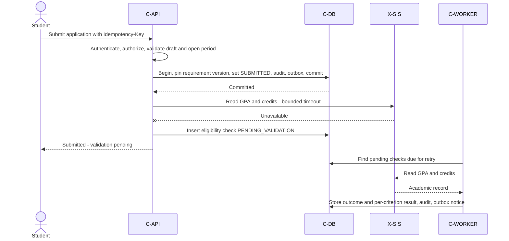
*Figure F08.* The submission is durable *before* any SIS call (BR-11, CL-011). Raw values are used only in memory (CL-017).

## 7.2 V-SEQ-02 — Two nominations race for the last place

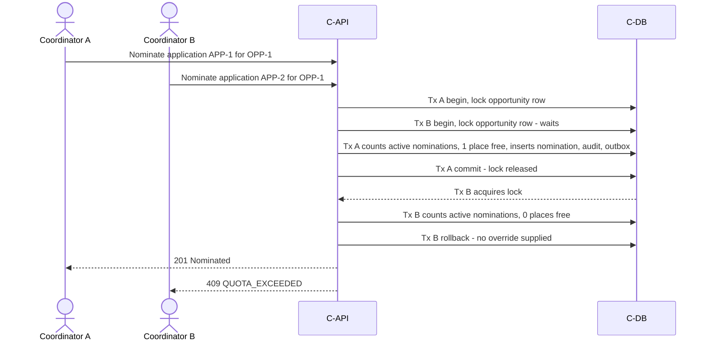
*Figure F09.* One possible interleaving; *which* request wins is unspecified, **safety** is specified. An in-memory fake or a single test client does not validate this; T-QUO-01 uses independent DB connections.

## 7.3 V-SEQ-03 — A confirmed partner change returns every active application

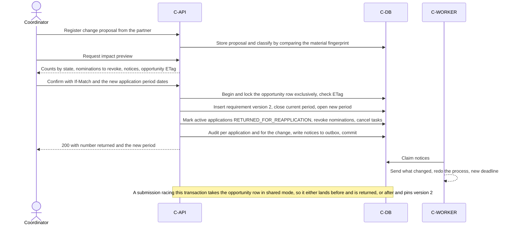
*Figure F10.* Drafts are kept. If the transaction fails nothing is returned; if notices fail afterwards the return stands and delivery is retried (BR-11).

## 7.3b V-SEQ-04 — Two acceptances at once

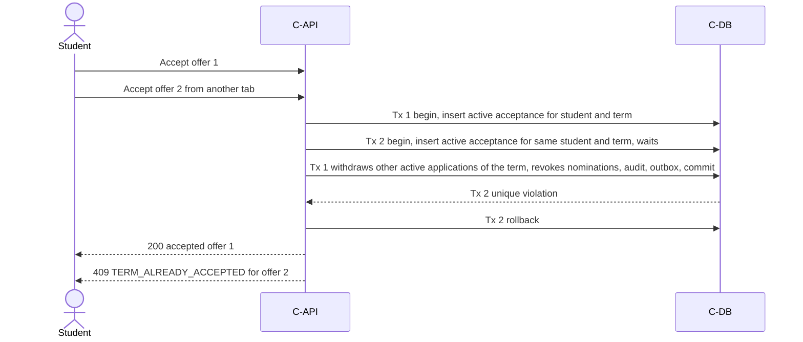
*Figure F10b.* Which acceptance wins is unspecified; safety is specified. The same cascade releases places that other coordinators can then nominate.

## 7.4 Failure matrix

| Failure point | Required durable result | User/operator outcome |
|---|---|---|
| Invalid / unauthorized command | No mutation | 4xx with defined code |
| Quota exceeded | Entire nomination rolled back; no success audit/outbox | `409 QUOTA_EXCEEDED` |
| DB failure before commit | No acknowledged success | `503`; client retries with same key |
| Commit succeeds, response lost | Receipt/state exists | Retry returns recorded outcome |
| SIS unavailable on submit | Submission committed; check pending | "Validation pending"; worker retries |
| SIS unavailable on nominate | Nomination does not re-query SIS (uses stored eligibility result) | Unaffected |
| Notification gateway down | Business state unchanged; delivery `RETRY_WAIT` | Visible to IT; `DEAD_LETTER` after budget |
| Worker crash after provider accepted | Lease expires; retried with same delivery key | Receiver/template idempotent |
| Document store write fails | No `DocumentVersion` row created | Student told to retry |
| Partner portal unavailable | Nomination stays committed; dossier delivery retried | Coordinator may record decision manually |
| Change confirmed, notice delivery fails | Return stands; notices retried | Visible to IT; dead-letter after budget |
| Student submits while a change is confirmed | Serialized by the opportunity lock | Returned (submitted before) or pinned to the new version (after) |
| Stale impact preview | Opportunity changed since the preview | `412`; preview recomputed |
| Two acceptances at once | Unique active acceptance | One success, one `409 TERM_ALREADY_ACCEPTED` |
| Offer expires during acceptance | Server time decides; one outcome | `409 OFFER_EXPIRED` |

Every row needs a test, an inspection or an explicit gap (see `test-plan.md`).

---

# 8. Interface definitions

## 8.1 Endpoint catalog (proposed contract, not implemented evidence)
Paths relative to `/api/v1`. Mutating commands require session, CSRF, server-side authorization; versioned resources use `If-Match`; retryable commands accept `Idempotency-Key`.

| Endpoint | Responsibility | Contract rule |
|---|---|---|
| `POST /opportunities` | Publish opportunity (version 1, first period) | Coordinator |
| `POST /opportunities/{id}/change-proposals` | Register a partner's proposed change | Coordinator; classification computed |
| `GET /change-proposals/{id}/impact` | Impact preview | Coordinator; returns opportunity ETag |
| `POST /change-proposals/{id}/confirmations` | Confirm and apply; if material, **new period dates required** | `If-Match`; atomic return of applications |
| `PUT /opportunities/{id}/partner-selection` | Register the partner's chosen candidates | Coordinator |
| `POST /nominations/{id}/acceptances` · `…/declinations` | Student accepts or declines an offer | Owner; offer open; one per term |
| `POST /opportunities/{id}/application-periods` | Open, close or **reopen** a period | Coordinator; reopening is also done by a confirmed change |
| `GET /opportunities?eligibleFor=me` | List opportunities I can apply to | Uses SIS read; may degrade to "unverified" |
| `POST /applications` · `PUT /applications/{id}` | Create/save draft | Owner derived from session |
| `POST /applications/{id}/submissions` | Submit | Pins version; idempotent; returns eligibility state |
| `POST /applications/{id}/withdrawals` | Withdraw | Reason mandatory |
| `POST /applications/{id}/documents` | Upload a new document **version** | Never overwrites |
| `POST /documents/{id}/versions/{n}/decisions` | Accept/reject with reason | Adviser in scope |
| `POST /applications/{id}/triage` · `…/correction-requests` | Completeness triage; request corrections | Recorded against application |
| `POST /applications/{id}/academic-decisions` | Record academic decision | Coordinator of the programme |
| `POST /applications/{id}/nominations` | Nominate (optional override) | Guards BR-02/04; `If-Match` |
| `POST /nominations/{id}/host-decisions` | Record admission/refusal | Coordinator |
| `GET /applications/{id}/status` | Combined status: workflow, eligibility, nomination, host decision, next action | Authorized, `no-store` |
| `GET/PUT /applications/{id}/predeparture` | Checklist (visa, insurance, briefing) | Adviser / owner for evidence |
| `GET /reports/applications` · `GET /reports/places-utilisation` | Pending, incomplete, delayed, at-risk; place utilisation | Scoped, bounded filters |
| `GET /applications/{id}/audit` | History | Authorized roles only |
| `POST /deliveries/{id}/replays` | Replay a dead-letter delivery | IT; reason; audited |

## 8.2 Worked exchange — nomination that exceeds the quota
Synthetic data: opportunity `OPP-2027-03`, 1 place, already taken; application `APP-0412`.

```http
POST /api/v1/applications/APP-0412/nominations HTTP/1.1
Cookie: imams_session=<opaque>
X-CSRF-Token: <token>
If-Match: "application-APP-0412-v9"
Idempotency-Key: nominate-app0412-001
Content-Type: application/json

{}
```
```http
HTTP/1.1 409 Conflict
Content-Type: application/problem+json

{
  "type": "urn:imams:problem:quota-exceeded",
  "title": "No places are available for this opportunity",
  "status": 409,
  "code": "QUOTA_EXCEEDED",
  "detail": "An authorized override with a written justification is required. No nomination was created.",
  "instance": "/api/v1/applications/APP-0412/nominations",
  "correlationId": "corr-demo-0412"
}
```
With override: body `{"override": {"justification": "…"}}`. Without the `nomination.override` permission → `403 OVERRIDE_NOT_PERMITTED`; empty justification → `422 VALIDATION_FAILED`. Success (`201`) returns `nominationId`, `status: AWAITING_HOST_DECISION` and `override: true/false`.

## 8.2b Impact preview and confirmation (synthetic)

```http
GET /api/v1/change-proposals/CP-007/impact
```
```json
{
  "proposalId": "CP-007",
  "opportunityId": "OPP-2027-03",
  "classification": "MATERIAL",
  "changedMaterialFields": ["minGpa"],
  "from": { "versionNo": 1, "minGpa": 3.0 },
  "to":   { "versionNo": 2, "minGpa": 3.4 },
  "applicationsToReturn": { "total": 6, "SUBMITTED": 2, "IN_ACADEMIC_REVIEW": 1, "READY_FOR_NOMINATION": 1, "NOMINATED": 2 },
  "nominationsToRevoke": { "AWAITING_HOST_DECISION": 1, "ADMITTED": 1 },
  "placesReleased": 2,
  "draftsKept": 3,
  "priorityApplicants": 4,
  "notices": { "students": 6, "advisers": 1, "academicCoordinators": 2, "mobilityCoordinator": 1 },
  "opportunityEtag": "opportunity-OPP-2027-03-v5"
}
```
```http
POST /api/v1/change-proposals/CP-007/confirmations
If-Match: "opportunity-OPP-2027-03-v5"
Idempotency-Key: confirm-cp007-001

{ "newApplicationPeriod": { "opensOn": "2027-02-01", "closesOn": "2027-02-20" } }
```
A stale ETag returns `412 PRECONDITION_FAILED` and a material change without period dates returns `422 VALIDATION_FAILED`. Success returns the number of applications returned and the new `periodNo`.

## 8.3 Error vocabulary

| Status | Code | Meaning / recovery |
|---|---|---|
| 400 | `REQUIRED_HEADER_MISSING` | Supply CSRF / key / precondition header |
| 401 | `SESSION_INVALID` | Re-authenticate |
| 403 | `ACTION_FORBIDDEN` · `OVERRIDE_NOT_PERMITTED` | No permission or scope; do not retry |
| 404 | `RESOURCE_NOT_FOUND` | Missing, or read concealed from unauthorized user |
| 409 | `QUOTA_EXCEEDED` | Choose override path or another opportunity |
| 409 | `NOT_NOMINATABLE` | Missing eligibility, accepted documents or academic approval |
| 409 | `INVALID_STATE` · `IDEMPOTENCY_KEY_REUSED` | Illegal transition / same key, different body |
| 409 | `TERM_ALREADY_ACCEPTED` | The student already accepted a mobility in this term |
| 409 | `OFFER_EXPIRED` | The acceptance window has closed |
| 409 | `PERIOD_CLOSED` | Submission/resubmission outside an open application period |
| 409 | `NOT_PARTNER_SELECTED` | Candidate was not chosen by the partner (when candidates exceed places) |
| 412 | `PRECONDITION_FAILED` | Reload and retry |
| 422 | `VALIDATION_FAILED` | Fix listed fields |
| 503 | `DEPENDENCY_UNAVAILABLE` | Retry later; state preserved |

## 8.4 Integration contracts (simulated)

**X-SIS — academic record (read-only).** `GET /students/{subject}/academic-record` → `{ "subject": "stu-0412", "gpa": 3.4, "completedCredits": 84, "enrolled": true, "recordVersion": "SIS-2027-0003", "asOf": "2027-01-10T12:00:00Z" }`. Adapter validates schema, positive credits, GPA range, known subject; timeout 5 s. IMAMS persists only `recordVersion`/`asOf` and per-criterion results. Mock must support delay, error and malformed-payload modes.

**X-PARTNER — nominations, change proposals, selections, decisions.** Outbound `PUT /partners/{partnerId}/nominations/{nominationId}` with a stable delivery key (re-sending is safe). Inbound records, entered by partner staff in the simulator and registered by the coordinator (ASM-007): `{ "type": "CHANGE_PROPOSAL", "opportunityId": "...", "changes": { "minGpa": 3.4 } }`, `{ "type": "SELECTION", "opportunityId": "...", "applicationIds": ["..."] }`, `{ "type": "DECISION", "nominationId": "...", "outcome": "ADMITTED|REFUSED", "decidedAt": "..." }`. IMAMS never applies a proposal by itself.

**Internal event (outbox).** `{ eventId, eventType (ApplicationSubmitted | ApplicationReturned | NominationCreated | HostDecisionRecorded | OfferAccepted | DeadlineReminder…), schemaVersion, aggregateId, aggregateVersion, occurredAt, correlationId, payload }`. Unknown schema versions are quarantined; payloads carry no document contents.

---

# 9. Security and privacy

## 9.1 Authorization matrix (proposed — pending role confirmation, esp. CL-008)

| Action | Student | Mobility Adviser | Mobility Coordinator | Academic Coordinator | IT Services |
|---|---|---|---|---|---|
| Create/submit/withdraw own application | Own only | — | — | — | — |
| Upload/replace own document version | Own only | — | — | — | — |
| Accept/reject documents, triage, request corrections | — | Assigned opportunities (ASM-006) | — | — | — |
| Publish opportunities / requirement versions | — | — | Yes | — | — |
| Academic decision | — | — | — | Own programme only | — |
| Nominate | — | — | Yes (validated applications) | — | — |
| **Override quota** | — | — | **Only with `nomination.override` + justification** | — | — |
| Record host decision | — | — | Yes | — | — |
| Register partner change proposal / selection | — | — | Yes | — | — |
| **Confirm a material change** (returns applications) | — | — | **Yes, after the impact preview** | — | — |
| Accept / decline an offer | Own offer only | — | — | — | — |
| Pre-departure checklist | Upload own evidence | Track and update | Read | — | — |
| Reports | — | Scoped | Yes | — | Operational only |
| Read audit history | — | Scoped | Yes | — | Yes |
| Replay failed delivery | — | — | — | — | Yes (reason required) |

Ownership, scope and current state are checked on every command; a role in the request body is never trusted. A hidden button is not a security control.

## 9.2 Trust boundaries and data classification
Browser = untrusted. API validates and authorizes. DB and document store are private (no public exposure). External/simulated systems' responses are untrusted until validated.

| Data | Class | Treatment |
|---|---|---|
| Passport/transcript/certification files | Sensitive | **Synthetic only** (ASM-009); encrypted at rest; streamed through API; never in logs |
| Application and review data | Restricted | Role + scope + ownership |
| Opportunity catalogue | Internal/public-like | Authenticated read |
| Audit and operational logs | Restricted | Separate business audit from operational logs; no tokens or document contents |

## 9.3 Threat model (scoped)

| Threat | Asset | Mitigation | Verification |
|---|---|---|---|
| Student guesses another application/document id | Privacy | Object-level ownership checks; concealed reads | T-SEC-02 |
| Adviser/academic coordinator acts outside scope | Review integrity | Scope on every command | T-SEC-03 |
| Coordinator overrides quota without permission/justification | Quota integrity | Distinct permission; mandatory justification; audit | T-QUO-02, T-SEC-01 |
| Forged or mistaken change proposal returns many applications | Student stability, partner trust | Partner has no IMAMS account; coordinator confirmation after impact preview; `If-Match`; audit of the change | T-CHG-03, T-SEC-01 |
| Forged state/owner in request body | Business integrity | Server-derived actor/owner; legal transitions only | T-SEC-01, T-LIFE-01 |
| CSRF on withdraw/nominate | Availability/integrity | Session-bound CSRF; cookie policy | T-SEC-04 |
| Malicious/oversized upload | Storage, users | Type/size limits; hash; store outside web root; safe download headers | T-DOC-02 |
| Injection via free-text | DB, UI | Parameterized queries; output encoding | T-SEC-05 |
| DB superuser edits audit | Audit trust | **Residual risk** R-021 | — |

This is a scoped review, not a penetration test or a compliance claim.

---

# 10. Deployment assumptions and validation approach

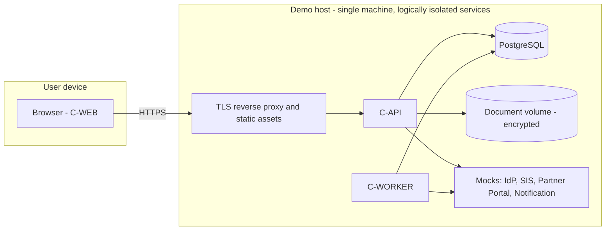
*Figure F11.* Proposed demonstration environment. One host/DB is **one failure domain**; it is not a high-availability design.

| Assumption | Value / statement | To document |
|---|---|---|
| Reproducibility | Containerized local environment with synthetic seed data | Startup, seed, reset and test commands (`T-ENV-01`) |
| Persistence | DB and document volume survive process restarts | Difference between restart and data loss (`T-REC-01`) |
| Integrations | All four external systems are simulated | What the mocks do **not** prove |
| Retry policy (proposed) | Worker poll ≤ 2 s; request timeout 5 s; backoff 5/10/20/30 s; max 12 attempts; 15 s lease | Tune/justify when measured |
| Secrets | Injected via environment; none in repository | Config separation |
| Data | Only fictitious students and synthetic documents | Re-confirm before any real data |

**Validation strategy (summary).** Unit tests for rules (eligibility boundaries, state machine, routing), database integration tests for constraints/rollback, API tests for authorization and idempotency, concurrency and fault-injection tests for quota and SIS outage, contract tests for adapters/mocks, a small UI task test for status clarity, and an architecture-dependency check. Details, IDs and "NOT EXECUTED" status are in [`validation/test-plan.md`](validation/test-plan.md). A diagram or contract specifies behaviour; it does not prove it.

---

# 11. Traceability (compact)

| Success criterion | Requirements | Driver / ADR | Views | Planned tests |
|---|---|---|---|---|
| SC-01 single entry point | US-007/008 | AD-07 / ADR-002 | V-CONT, V-SEQ-01 | T-LIFE-01, T-ENV-01 |
| SC-02 automatic eligibility | US-012, US-036 | AD-01, AD-05 / ADR-001, 005 | V-SEQ-01, V-DATA | T-ELIG-01, T-INT-01 |
| SC-03 quota | US-022/023 | AD-02 / ADR-003 | V-SEQ-02, 6.3 | T-QUO-01/02/03 |
| SC-04 status + next action | US-009 | AD-03 / ADR-004 | 6.5, status endpoint | T-STAT-01, T-UX-01 |
| SC-05 documents + expiry | US-013/014/015 | AD-06 / ADR-008 | V-DATA | T-DOC-01 |
| SC-06 nomination ≠ admission | US-024/025 | AD-03 / ADR-004 | V-STATE-NOM | T-STAT-01, T-UX-01 |
| SC-07 academic review before nomination | US-019/020 | AD-03 / ADR-004 | V-STATE-APP | T-QUO-03, T-LIFE-01 |
| SC-08 audit | US-033 | AD-04 / ADR-006 | V-DATA | T-AUD-01/02 |
| SC-09 report | US-032 | AD-06 | V-COMP | T-RPT-01 (needs CL-016) |
| SC-10 *(to be rewritten, see note)* partner change | US-002/004 + new stories | AD-01, AD-04 / ADR-001, 010 | V-SEQ-03, 6.4 | T-VER-01, T-CHG-01/02/03, T-PRI-01 |
| *Proposed SC-12* one accepted mobility per student per term | New stories | AD-08 / ADR-011 | V-SEQ-04, 6.5 | T-ACC-01/02/03 |
| *Proposed SC-13* partner selection among valid candidates | New story | AD-02 / ADR-003 | 6.5 | T-SEL-01 |
| SC-11 end-to-end workflow | all Must | all | all | PoC slice |

> **SC-10 and the traceability row of STK-03 now contradict the client rule.** Proposed rewrite: *"Given a confirmed material change to an opportunity, then all its active applications are returned for reapplication and everyone concerned is notified of the change, the need to redo the process and the new deadline; a non-material change returns none."*

**Reverse trace example — C-WORKER.** It exists because a committed submission or nomination must survive SIS/notification outages (US-036, ASM-008, QS-03, QS-07). ADR-007 selects the outbox. The worker claims rows from C-DB, calls adapters, and records outcomes without deciding eligibility or nominations. It appears in the container, deployment and failure views; T-INT-01 and T-NOT-01 challenge it.

---

# Glossary

| Term | Meaning |
|---|---|
| Application | Student's request for an opportunity |
| Nomination | Horizon's endorsement of a validated candidate (not admission) |
| Host decision | Partner university's admission/refusal |
| Requirement version | Immutable set of rules for an opportunity at a point in time |
| Pinned version | The requirement version recorded on an application at submission |
| Override | Authorized nomination beyond the available places, with mandatory justification |
| Outbox | Integration intent written in the same transaction as the business change |
| Port / adapter | Interface owned by the application / its concrete provider implementation |
| ADR | Architecture Decision Record |
| Material change | Change to GPA, credits, language level, required documents, application period or destination; triggers return |
| Return for reapplication | System-driven end of an application after a confirmed material change; the student must apply again |
| Application period | Dated window in which applications to an opportunity are accepted; a new one opens after a material change |
| Term | The mobility period (e.g. 2027-S1) used for the one-accepted-mobility rule |
| Acceptance | The student's confirmation of an offered mobility |
| Priority applicant | Student whose returned application had reached academic approval or beyond |

# References
Course guide: *DH00 Evaluation 2 Student Guide* (structure, templates, examples — DH-00 decisions are not prescribed for this project). C4 model (c4model.com), arc42 (arc42.org), Nygard — *Documenting Architecture Decisions*, PostgreSQL documentation (explicit locking, constraints), RFC 9110 (HTTP semantics), RFC 9457 (Problem Details), OWASP Authorization and Session Management cheat sheets.
